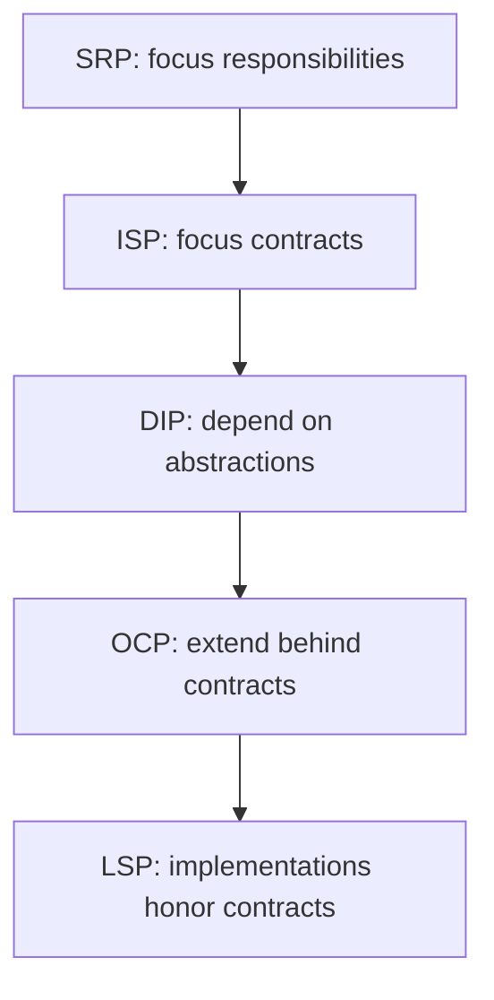
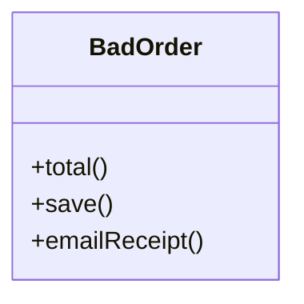
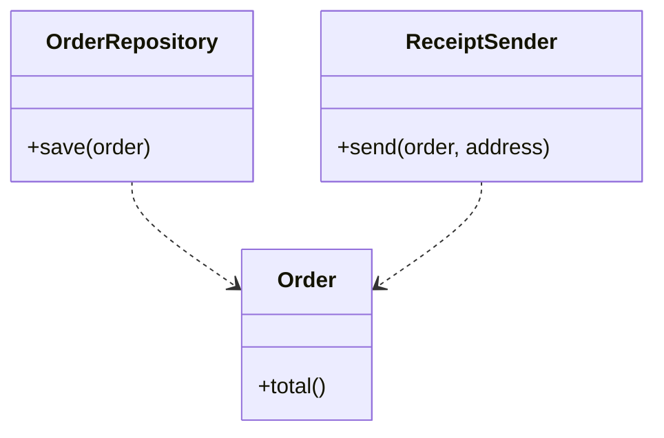
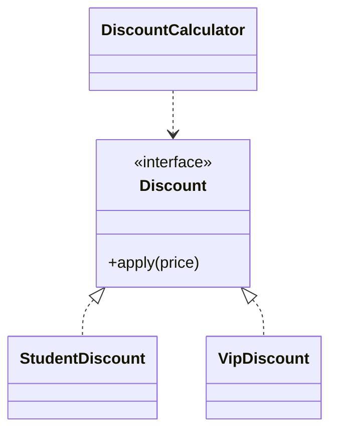
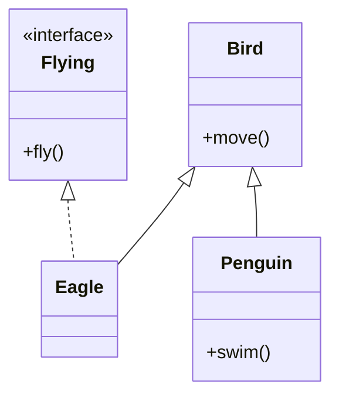
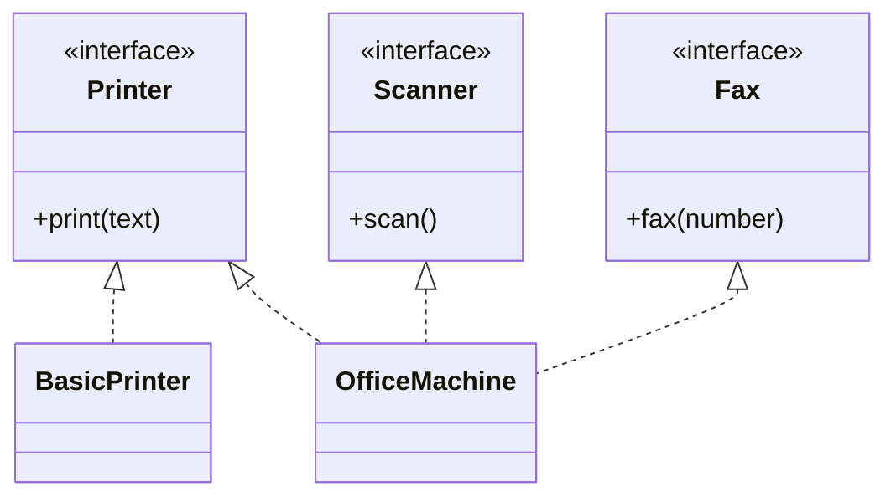
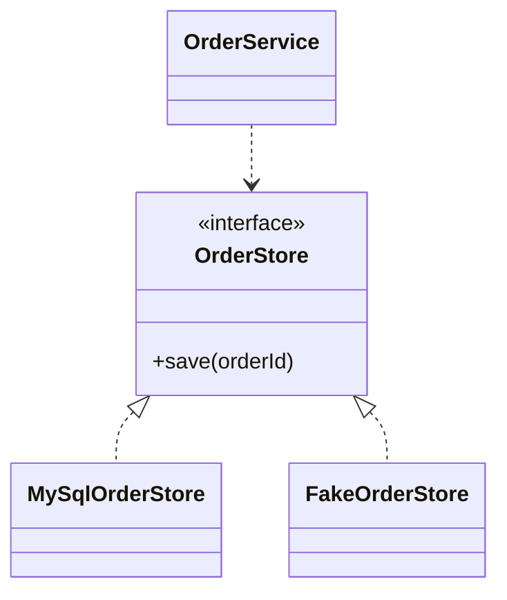
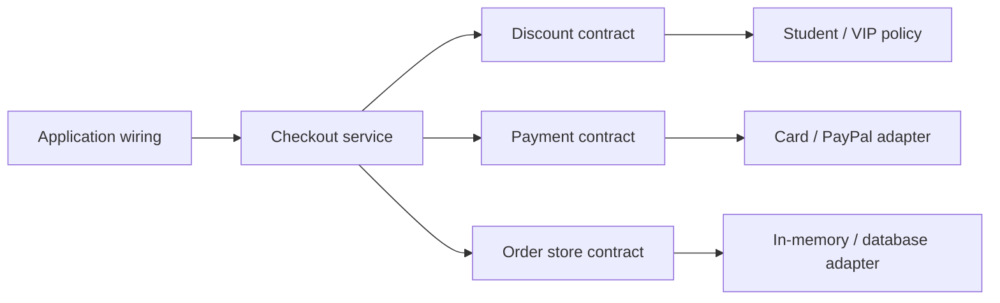
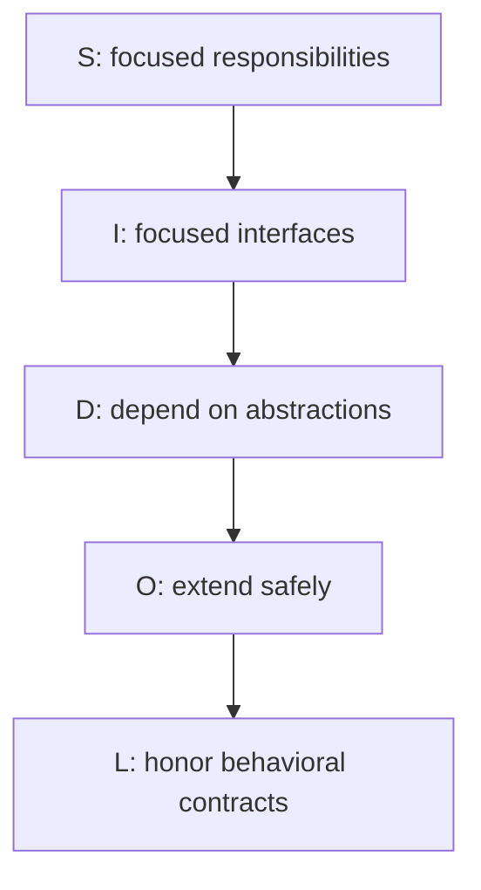

# SOLID Principles in PHP

A concise study guide for PHP students. Examples use PHP 8.1+ and a small online store.

## What you will learn

- What the five SOLID principles mean and why they help.
- How to recognize common design problems.
- How to improve a design using PHP classes, interfaces, and composition.
- How to run simple examples and review the principles before an exam.

> SOLID is guidance, not a rule to create an interface or class for everything. Use it when it makes code easier to understand, test, or change.

## 1. Before SOLID: basic terms

**Software design** is how we organize code and its relationships. A good design makes likely changes easier and limits unintended effects.

**Object-oriented programming (OOP)** organizes programs around objects:

- A **class** is a template for objects.
- An **object** is an instance of a class.
- **Properties** hold data; **methods** define behavior.

```php
<?php
class Product
{
    public function __construct(
        public string $name,
        public float $price
    ) {}
}

$book = new Product('PHP Basics', 25.00);
echo $book->name; // PHP Basics
```

A **responsibility** is a kind of work a component does. **Cohesion** describes how closely that work belongs together. **Coupling** describes how much one component depends on another component's details. In general, aim for focused responsibilities and avoid unnecessary dependencies.

**Maintainability** is how easy software is to understand, fix, and extend. **Technical debt** is the future cost of shortcuts that make changes harder.

SOLID is an acronym for five object-oriented design principles popularized by Robert C. Martin:

| Letter | Principle | Main question |
|---|---|---|
| S | Single Responsibility Principle | Does this part have one focused reason to change? |
| O | Open/Closed Principle | Can I add a behavior without repeatedly changing stable code? |
| L | Liskov Substitution Principle | Can a subtype honor what its parent promises? |
| I | Interface Segregation Principle | Does a client depend only on operations it needs? |
| D | Dependency Inversion Principle | Does business logic depend on a contract rather than a concrete detail? |



The principles support one another, but they answer different design questions.

## 2. SRP — Single Responsibility Principle

> **A class should have one reason to change.**

In other words, give a class one coherent job. This does not mean one method per class.

### Example: an order that saves and emails itself

**Problem:** the order class handles order data, persistence, and email delivery. A change to the database or email provider can force changes to the order class.

```php
<?php
// BAD: pricing, persistence, and email are mixed together.
class BadOrder
{
    public function __construct(public array $prices) {}

    public function total(): float
    {
        return array_sum($this->prices);
    }

    public function save(): string
    {
        return 'saved:' . $this->total();
    }

    public function emailReceipt(string $address): string
    {
        return "emailed:$address";
    }
}
```

**Improved design:** keep order information and calculation together, and give storage and email their own collaborators.

```php
<?php
class Order
{
    public function __construct(public array $prices) {}

    public function total(): float
    {
        return array_sum($this->prices);
    }
}

class OrderRepository
{
    public function save(Order $order): string
    {
        return 'saved:' . $order->total();
    }
}

class ReceiptSender
{
    public function send(Order $order, string $address): string
    {
        return "emailed:$address:" . $order->total();
    }
}

$order = new Order([12.00, 8.00]);
assert($order->total() === 20.00);
assert((new OrderRepository())->save($order) === 'saved:20');
assert((new ReceiptSender())->send($order, 'a@example.test') === 'emailed:a@example.test:20');
echo "SRP checks passed\n";
```

`Order` calculates its total. `OrderRepository` saves. `ReceiptSender` sends the receipt. Each part can change for a more focused reason.



The bad class combines three jobs.



The improved design separates calculation, storage, and delivery.

**Warning signs:** a class has unrelated verbs such as `calculate`, `save`, `render`, and `send`; unrelated requirements often change the same class.

**Common mistake:** splitting every method into its own class. Keep methods together when they support the same responsibility.

## 3. OCP — Open/Closed Principle

> **Software should be open for extension but closed for modification.**

This means common new behaviors should often be added without editing stable core logic. It does **not** mean existing code is never changed.

### Example: discounts

**Problem:** every new discount adds another branch to the calculator.

```php
<?php
// BAD: this function must change for each new discount.
function badDiscount(string $type, float $price): float
{
    if ($type === 'student') {
        return $price * 0.90;
    }
    if ($type === 'vip') {
        return $price * 0.80;
    }
    return $price;
}
```

Use an interface as a contract: it says which operation each discount provides.

```php
<?php
interface Discount
{
    public function apply(float $price): float;
}

class StudentDiscount implements Discount
{
    public function apply(float $price): float
    {
        return $price * 0.90;
    }
}

class VipDiscount implements Discount
{
    public function apply(float $price): float
    {
        return $price * 0.80;
    }
}

class DiscountCalculator
{
    public function finalPrice(float $price, Discount $discount): float
    {
        return $discount->apply($price);
    }
}

$calculator = new DiscountCalculator();
assert($calculator->finalPrice(100, new StudentDiscount()) === 90.0);
assert($calculator->finalPrice(100, new VipDiscount()) === 80.0);
echo "OCP checks passed\n";
```

To add a new discount, create another class that implements `Discount`; the calculator does not need another branch. This is an example of **polymorphism**: different objects provide the same operation.



The calculator uses the contract instead of checking each discount's name.

**When useful:** when behaviors vary and new types are reasonably likely. Do not build an extension framework for a stable, tiny conditional without a real need.

## 4. LSP — Liskov Substitution Principle

> **A subtype should be usable wherever its parent type is expected, without breaking the program.**

A parent class makes promises to callers. A child class must honor those promises. Inheritance is only useful when this behavioral relationship is true.

### Example: birds that cannot fly

**Problem:** if every `Bird` promises a `fly()` method, a penguin either lies or throws an error.

```php
<?php
// BAD: Penguin cannot honor the Bird::fly() promise.
class BadBird
{
    public function fly(): string
    {
        return 'flying';
    }
}

class BadPenguin extends BadBird
{
    public function fly(): string
    {
        throw new LogicException('Penguins cannot fly');
    }
}
```

Model the capability separately:

```php
<?php
class Bird
{
    public function move(): string
    {
        return 'moving';
    }
}

interface Flying
{
    public function fly(): string;
}

class Eagle extends Bird implements Flying
{
    public function fly(): string
    {
        return 'flying';
    }
}

class Penguin extends Bird
{
    public function swim(): string
    {
        return 'swimming';
    }
}

function takeOff(Flying $bird): string
{
    return $bird->fly();
}

assert(takeOff(new Eagle()) === 'flying');
assert((new Penguin())->swim() === 'swimming');
echo "LSP checks passed\n";
```

Now, only objects that support flight can be passed to `takeOff()`.



The hierarchy models shared behavior and flight capability separately.

**More examples:** a read-only repository should not inherit a promise to save; a payment that cannot be refunded should not be passed where a refundable payment is required.

**Warning signs:** child methods throw “not supported,” silently do nothing, or behave in a way that surprises callers of the parent.

## 5. ISP — Interface Segregation Principle

> **Clients should not be forced to depend on methods they do not use.**

An interface defines operations a class offers. A **fat interface** has operations that some implementations or clients do not need.

### Example: a basic printer

**Problem:** a print-only device should not have to implement scanning and faxing.

```php
<?php
interface Printer
{
    public function print(string $text): string;
}

interface Scanner
{
    public function scan(): string;
}

interface Fax
{
    public function fax(string $number): string;
}

class BasicPrinter implements Printer
{
    public function print(string $text): string
    {
        return "printed:$text";
    }
}

class OfficeMachine implements Printer, Scanner, Fax
{
    public function print(string $text): string
    {
        return "printed:$text";
    }

    public function scan(): string
    {
        return 'scanned';
    }

    public function fax(string $number): string
    {
        return "faxed:$number";
    }
}

assert((new BasicPrinter())->print('invoice') === 'printed:invoice');
assert((new OfficeMachine())->scan() === 'scanned');
echo "ISP checks passed\n";
```

Each class implements only the capabilities it actually supports.



The basic printer implements only `Printer`; the office machine supports all three capabilities.

**SRP vs ISP:** SRP asks whether a class has one coherent reason to change. ISP asks whether a client is forced to depend on operations it does not use.

## 6. DIP — Dependency Inversion Principle

> **Business logic should depend on abstractions, not directly on low-level details.**

A **high-level module** contains business rules, such as placing an order. A **low-level module** handles details, such as MySQL or an email provider. An **abstraction** is a contract describing what the business logic needs.

### Example: order service and storage

**Tightly coupled:** the order service creates a database class internally. That makes changing storage and testing the service harder.

```php
<?php
interface OrderStore
{
    public function save(string $orderId): string;
}

class MySqlOrderStore implements OrderStore
{
    public function save(string $orderId): string
    {
        return "mysql:$orderId";
    }
}

class OrderService
{
    public function __construct(private OrderStore $store) {}

    public function place(string $orderId): string
    {
        return $this->store->save($orderId);
    }
}

class FakeOrderStore implements OrderStore
{
    public array $saved = [];

    public function save(string $orderId): string
    {
        $this->saved[] = $orderId;
        return 'saved';
    }
}

$fake = new FakeOrderStore();
$service = new OrderService($fake); // Constructor dependency injection
assert($service->place('order-1') === 'saved');
assert($fake->saved === ['order-1']);
echo "DIP checks passed\n";
```

The service depends on `OrderStore`, not on `MySqlOrderStore`. The application supplies the real database adapter in production and a fake in a test.



The high-level service depends on the contract; concrete implementations sit behind it.

### DIP is not DI

- **DIP** is a design principle about dependency direction.
- **Dependency Injection (DI)** is a technique: supply an object's dependencies from outside, often through its constructor.

Constructor injection helps with DIP, but injecting a concrete MySQL class is still a dependency on that concrete detail.

## 7. Putting the ideas together

A small online-store flow can be organized like this:

```text
Product and Order        Domain data and business rules (SRP)
Discount                 Replaceable discount policy (OCP)
PaymentGateway           Payment capability contract (ISP)
OrderStore               Persistence contract (DIP)
CheckoutService          Coordinates checkout
Application startup      Supplies real implementations (DI)
```



The business flow uses contracts. New policies or adapters can be supplied without making checkout know their implementation details. Each implementation must honor its contract (LSP).

## 8. Compare the principles

| Principle | Problem it addresses | Online-store example |
|---|---|---|
| SRP | One class mixes unrelated jobs | Separate order data, persistence, and receipt sending |
| OCP | Every new variation edits central logic | Add a discount class instead of another `if` |
| LSP | A subtype breaks a parent's promise | A penguin is not a flying bird |
| ISP | A client must depend on unused methods | Basic printer needs only `print()` |
| DIP | Business code depends on infrastructure details | Checkout uses `OrderStore`, not MySQL directly |

Frequent distinctions:

- **SRP vs ISP:** class/module responsibility versus client-facing operations.
- **OCP vs DIP:** ease of extension versus direction of dependency.
- **LSP vs inheritance:** inheritance is a mechanism; LSP is the behavioral requirement for substitutable types.
- **DIP vs DI:** principle versus technique.

## 9. Try it yourself

### Run the examples

1. Save a code example in a `.php` file, for example `discounts.php`.
2. Open a terminal in that folder.
3. Check syntax with `php -l discounts.php`.
4. Run it with `php discounts.php`.
5. Assertions are silent when they pass. The final `echo` confirms the example ran.

If assertions appear disabled in your PHP configuration, run with `php -d zend.assertions=1 discounts.php`.

### Exercises

1. A `Product` class calculates prices, writes SQL, and formats HTML. Which principle is relevant, and how would you split the work?
2. A discount calculator has a new `if` for every sale type. How could you apply OCP?
3. A `Penguin` extends `Bird`, but throws from `fly()`. What is wrong?
4. A read-only data source must implement `save()`. Which principle is involved?
5. `Checkout` constructs `new MySqlOrderStore()` internally. How could a test use a fake?

### Short answers

1. **SRP:** keep product data/rules together; move storage to a repository and HTML formatting to a view/renderer.
2. Define a `Discount` interface and implement each discount as a class.
3. **LSP:** the child cannot honor the parent's flight promise; model `Flying` as a separate capability.
4. **ISP:** split read and write operations into focused contracts.
5. **DIP/DI:** inject an `OrderStore` interface into checkout and pass a fake implementation in tests.

## 10. Exam revision

1. **What does SRP mean?** One focused reason to change, not one method.
2. **What does OCP mean?** Make likely extensions possible without repeatedly editing stable core behavior.
3. **What does LSP mean?** A subtype must preserve the behavior callers expect from its parent.
4. **What does ISP mean?** Clients should not be forced to depend on operations they do not use.
5. **What does DIP mean?** High-level business rules should depend on abstractions, not infrastructure details.
6. **What is polymorphism?** Different implementations can be used through a common contract.
7. **What is an interface in PHP?** A contract that implementing classes must fulfill.
8. **Does DI automatically mean DIP?** No. DI can still inject a concrete implementation.
9. **Is inheritance always required for SOLID?** No. Composition and interfaces are often better.
10. **Should every class have an interface?** No. Add abstractions when they clarify a real boundary or likely variation.

## Final checklist

- Is each class's responsibility easy to explain?
- Are unrelated jobs separated?
- Can likely new behaviors be added without growing central conditionals?
- Do implementations honor their contracts?
- Are interfaces focused on client needs?
- Does business logic depend on contracts rather than database or provider details?
- Can I test the business behavior with simple fakes?
- Is the design simpler after applying the principle?



Remember: SOLID helps you manage change. It is not a goal to maximize the number of classes, interfaces, or design patterns.
